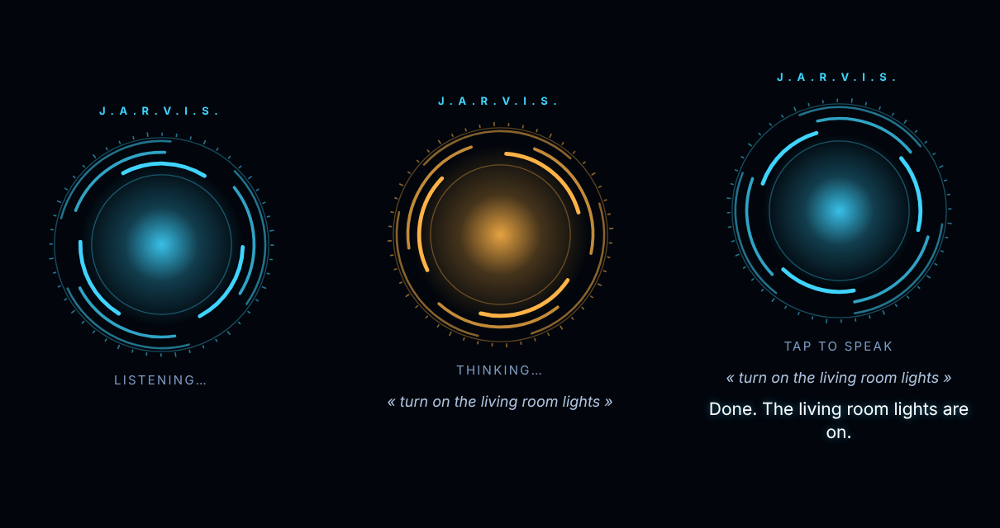

# Jarvis Card

Talk to Home Assistant **Assist** from any phone, tablet or browser, with an animated "reactor" ring that reacts to your voice — the same face as the [WallDock](https://github.com/psycho1807/WallDock) wall-panel app.



- Tap the screen and speak: the ring listens (blue, follows your voice), thinks (orange) and answers out loud with your pipeline's voice
- Shows what it heard and the answer
- Stops listening on its own when you stop talking; follows up automatically when Assist asks a question back
- Works with any Assist pipeline (Home Assistant Cloud, local Whisper/Piper, OpenAI, Claude, Gemini…)
- Works inside the Home Assistant Companion app on iPhone and Android, and in desktop browsers
- English and French

## Install

**HACS / Marketplace:** add this repository as a custom repository (type *Dashboard*), install **Jarvis Card**, then reload the page.

**Manual:** copy `jarvis-card.js` to `/config/www/`, then add `/local/jarvis-card.js` as a dashboard resource of type *JavaScript module*.

## Use

The card is meant to fill a whole view. Create a dashboard (or a view) of type **Panel** with:

```yaml
type: custom:jarvis-card
pipeline: 01abc...   # optional – Assist pipeline id, default: your preferred pipeline
title: J.A.R.V.I.S.  # optional, legacy display title
name: Alfred       # optional, overrides title
theme: gotham     # optional: classic (default) or gotham
```

The `name` changes only the displayed assistant name. To change the spoken wake word (for example, “Hey Alfred”), configure a compatible wake-word model separately in Home Assistant or WallDock. The `theme` option only changes the visual animation; the Assist pipeline and voice are unchanged.

Find the pipeline id in **Settings → Voice assistants** (it is in the address bar when you open a pipeline).

### iPhone tip

Create a Shortcut named **Jarvis** with the action *Open URL* `homeassistant://navigate/<your-dashboard>/<your-view>` — then "Hey Siri, Jarvis" opens the card. iOS requires a tap before the microphone and sound can start.

## Requirements

- An Assist pipeline with speech-to-text and text-to-speech
- Microphone access: Home Assistant must be opened over **https** (or on `localhost`) for the browser to allow the microphone

---

### Français

Parlez à Assist depuis un téléphone, une tablette ou un navigateur, avec l'anneau animé de Jarvis (le même que dans l'appli [WallDock](https://github.com/psycho1807/WallDock)). Touchez l'écran, parlez : l'anneau écoute, réfléchit et répond avec la voix de votre pipeline. Installation et configuration ci-dessus ; l'interface s'affiche en français si Home Assistant est en français.

## License

GPL-3.0 — part of the WallDock project.
